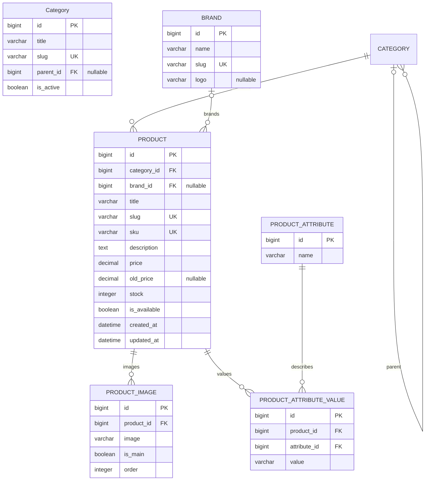

# Products ER diagram

This diagram describes the products application.
Other applications are documented by their owners.

## Deletion rules

- Category.parent: CASCADE.
- Prodcut.category: PROTECT.
- Product.brand: SET_NULL.
- ProductImage.product: CASCADE.
- ProductAttributeValue.product: CASCADE.
- ProductAttributeValue.attribute: CASCADE.

Image fields store file paths in the database.